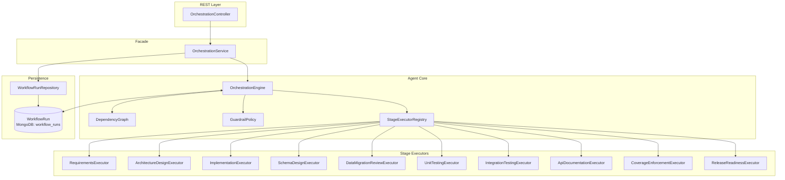
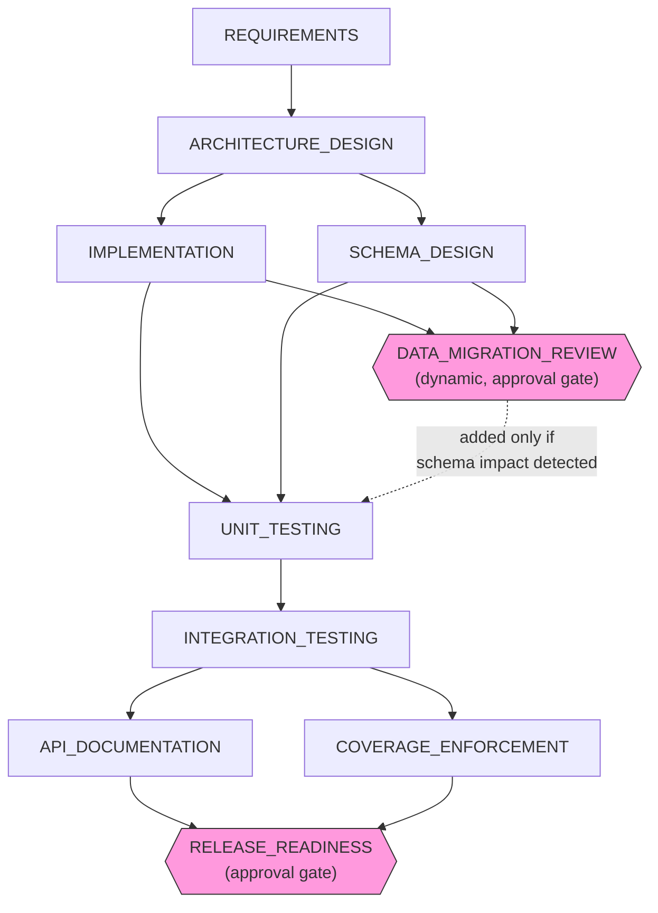
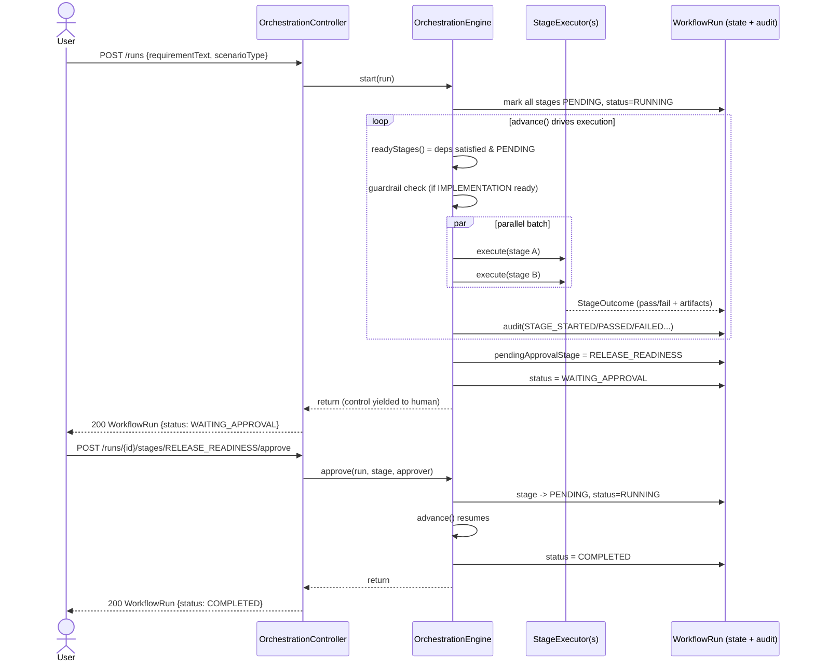
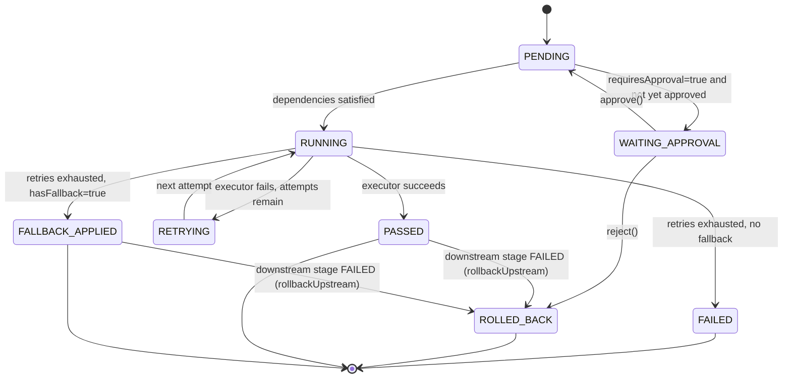

# Agent Design: How the Orchestration Engine Works

This document is the technical design reference for the agent implemented under
`src/main/java/com/urlshortener/orchestration/`. It complements `ORCHESTRATION.md`
(concept-to-code mapping, historical rationale) and `SCENARIOS.md` (worked examples)
with diagrams and an internals walkthrough of *how* the agent actually executes.

---

## 1. Component Architecture

**Responsibilities**

| Component | Role |
|---|---|
| `OrchestrationController` | REST entry points: start/inspect runs, approve/reject gates, stop, metrics |
| `OrchestrationService` | Facade — loads/saves `WorkflowRun` via the repository around each engine call |
| `OrchestrationEngine` | The agent's "brain": scheduling, parallelism, retries, gates, rollback, re-planning |
| `DependencyGraph` | Immutable, shared SDLC graph (10 stages, static deps, retry/approval/fallback config) |
| `GuardrailPolicy` | Stateless policy check invoked before risky stages execute |
| `StageExecutorRegistry` / `*Executor` | One executor per stage — the actual "work" (or its simulation) for that SDLC phase |
| `WorkflowRun` | Mutable aggregate root: per-stage results, audit trail, counters — the agent's working memory |

---

## 2. The SDLC Dependency Graph (What the Agent Plans Against)

- Solid arrows = static dependencies, registered once in `DependencyGraph` (immutable, shared by all runs).
- The dashed edge is **per-run only**: `DependencyGraph.effectiveDependsOn()` adds `DATA_MIGRATION_REVIEW`
  as a dependency of `UNIT_TESTING` for a specific `WorkflowRun` without mutating the shared graph — this
  is the mechanism behind dynamic re-planning (§5).
- Diamond nodes are **human approval gates** (`requiresApproval = true` in `StageDefinition`).
- Branch points (`ARCHITECTURE_DESIGN → {IMPLEMENTATION, SCHEMA_DESIGN}` and
  `INTEGRATION_TESTING → {API_DOCUMENTATION, COVERAGE_ENFORCEMENT}`) are executed **in parallel**
  by the engine and synchronized (fan-in) before the next stage becomes ready.
- Each stage also carries `maxRetries` and `hasFallback` (e.g. `API_DOCUMENTATION` and
  `COVERAGE_ENFORCEMENT` have fallbacks; core stages like `IMPLEMENTATION`/`UNIT_TESTING` do not,
  so their permanent failure triggers rollback instead).

---

## 3. Run Lifecycle — Sequence Diagram (Happy Path + Gate)

Key property: **`advance()` is synchronous and re-entrant.** It always runs as far as
possible — batch after batch — until it hits a terminal state, a gate, or no further
ready stages, then returns control. This makes "the agent works autonomously between
checkpoints" a deterministic, testable loop rather than an actor/callback system.

---

## 4. Stage State Machine

Both `PASSED` and `FALLBACK_APPLIED` count as "satisfied" for downstream dependency
checks (`isSatisfied()`), which is what lets the run keep progressing after a
recovered failure instead of stalling.

---

## 5. Key Behaviors Implemented

### 5.1 Parallel execution & synchronization
`readyStages()` computes *all* stages whose deps are satisfied in one pass; independent
stages in the same batch (e.g. `IMPLEMENTATION` + `SCHEMA_DESIGN`) run concurrently via
`CompletableFuture.runAsync` on a fixed 4-thread pool and are joined with
`CompletableFuture.allOf(...).join()` before the loop re-evaluates readiness — this is
the fan-out/fan-in ("sync point") behavior.

### 5.2 Bounded retries, fallback, rollback
`executeStageWithRetries()` retries a failing stage up to `StageDefinition.maxRetries()`.
On exhaustion:
- if the stage `hasFallback()` → marked `FALLBACK_APPLIED` (degrades gracefully, run continues)
- else → marked `FAILED`, and `rollbackUpstream()` invalidates that stage's **already-passed
  upstream dependencies** (marking them `ROLLED_BACK`), since a downstream failure means their
  "done" verdict can no longer be trusted. (Dependents can't be rolled back — in a valid DAG
  they cannot have executed yet.)

### 5.3 Human approval gates
`DATA_MIGRATION_REVIEW` and `RELEASE_READINESS` require approval. When such a stage becomes
ready but isn't yet approved, the engine parks it in `WAITING_APPROVAL`, sets
`run.pendingApprovalStage`, sets the run status to `WAITING_APPROVAL`, and returns — no
further stages execute until `OrchestrationController`/`approve()` or `reject()` is called.

### 5.4 Security/compliance guardrails
Before `IMPLEMENTATION` is allowed to run, `GuardrailPolicy.evaluate(requirementText)` scans
for disallowed phrases (e.g. "disable auth", "hardcode secret"). A violation reuses the same
gate mechanism — `IMPLEMENTATION` is forced to `WAITING_APPROVAL` with a `GUARDRAIL_VIOLATION`
audit event — so a human must explicitly approve or reject before risky work proceeds.

### 5.5 Dynamic re-planning
`ImplementationExecutor` inspects brownfield requirement text for schema-related keywords
("schema", "field", "column", "migrate"/"migration"). If found, its `StageOutcome` sets
`triggersReplan=true`. The engine's `replan()` then injects `DATA_MIGRATION_REVIEW` into
`run.dynamicallyAddedStages` and creates its `StageResult` — the **shared** `DependencyGraph`
is never mutated; `effectiveDependsOn()` layers the extra edge in per-run.

### 5.6 Audit trail & observability
Every state transition calls `run.audit(stage, EventType, message)`, appending an immutable
`AuditEvent` (timestamped) to the run — giving a complete, ordered log of what the agent did
and why (`STAGE_STARTED/PASSED/FAILED`, `RETRY_SCHEDULED`, `FALLBACK_APPLIED`, `ROLLBACK`,
`GATE_BLOCKED`, `APPROVAL_GRANTED/REJECTED`, `GUARDRAIL_VIOLATION`, `RE_PLAN`, `RUN_STOPPED`,
`RUN_COMPLETED`). Aggregate reliability metrics (success rate, avg retries/rollbacks/replans,
end-to-end latency) are exposed via `GET /api/v1/orchestration/metrics`.

### 5.7 Safe-stop
`stop(run)` is a no-op on already-terminal runs; otherwise it halts progress immediately
(`status=STOPPED`), preserving whatever stages already completed — an explicit "kill switch"
distinct from failure/rollback.

---

## 6. Why This Design

- **Determinism over concurrency-across-calls**: `advance()` does all its work
  synchronously within one call (parallel *within* a batch, but the batch join happens
  before returning), so engine behavior is unit-testable without timing flakiness —
  see `OrchestrationEngineTest`'s 8 scenarios for the executable spec of this design.
- **Immutable shared graph + per-run overlay**: avoids cross-run interference from
  dynamic re-planning while keeping the graph definition simple and centrally auditable.
- **Reusing one gate mechanism for two purposes** (approval requirements *and* guardrail
  violations) keeps the state machine small: there is exactly one "blocked, needs a human"
  state (`WAITING_APPROVAL`) rather than parallel special cases.
